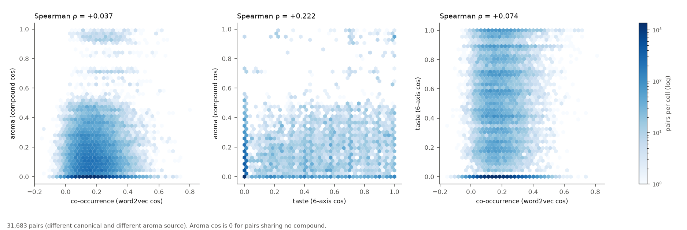
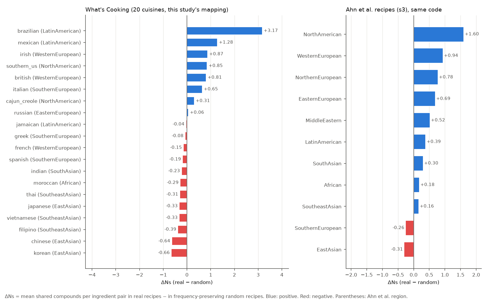

# Exp-10 香りの層（主要結果）

- 香りデータ: Ahn et al. 2011 の食材×香り化合物表（Zenodo 版、CC BY 4.0。化合物の出所は Fenaroli's Handbook 第5版）。1524 食材 × 1107 化合物（farnesol を食材から除いた）。食材あたりの化合物数は中央値 2・最大 239 と偏りが大きい
- 照合: 表を食材ペアに射影した共有化合物数が論文補足 s2 の 221,777 ペアと一致（不一致 0、s2 に無い正のペア 0）
- 近さの定義は run.py 冒頭。実行設定・所要時間は run_log.md、数値の全体は metrics.json

## 0. 対応づけ

303 食材 → auto 189・manual 81・none 33。**対応率 89.1%**（270/303、対応先の Ahn 食材 109 種）。表は `data/labels/aroma_mapping.csv`。

none: salt, water, kosher salt, baking powder, salsa, baking soda, sea salt, garam masala, mayonaise, curry powder, worcestershire sauce, coarse salt, warm water, capers, cold water, mirin, eggplant, sauce, ketchup, hoisin sauce, vegetable broth, italian seasoning, cajun seasoning, hot water, boiling water, pinenuts, tomatillos, sriracha, enchilada sauce, fine sea salt, juice, creole seasoning, taco seasoning

注意: 対応は 1 対 1 で、加工・発酵・加熱による香りの違いは入らない（例: 醤油の各種 → soy_sauce、tomato paste → tomato）。唐辛子類 13 種は cayenne、精製糖は cane_molasses に寄せた（Ahn らのレシピでの使われ方から推定した寄せ方。理由は対応表の note）。

## 1–2. 近さの順位相関

対象: 香りに対応でき、味が全軸 0 でない 254 食材（対応先 102 種）。ペア数: 全 32,131 / 同じ canonical を除く 31,826 / さらに対応先が同じペアも除く 31,683。最後の集合で共有化合物 0 のペアが 31%（香りの近さに同順位が多い）。

### 共起・味・香り（Spearman ρ）

| 比較 | 全ペア | 同じ canonical を除く | さらに対応先が同じペアも除く |
|---|---|---|---|
| 共起（word2vec cos） × 味（6 軸 cos） | +0.104 | +0.081 | +0.074 |
| 共起（word2vec cos） × 香り（化合物 cos） | +0.071 | +0.045 | +0.037 |
| 共起（word2vec cos） × 香り（Jaccard） | +0.069 | +0.043 | +0.035 |
| 共起（word2vec cos） × 香り（共有化合物数） | +0.046 | +0.026 | +0.020 |
| 味（6 軸 cos） × 香り（化合物 cos） | +0.252 | +0.232 | +0.222 |
| 味（6 軸 cos） × 香り（Jaccard） | +0.249 | +0.229 | +0.220 |
| 味（6 軸 cos） × 香り（共有化合物数） | +0.192 | +0.175 | +0.168 |
| 味（−ユークリッド距離） × 香り（化合物 cos） | +0.178 | +0.156 | +0.147 |
| 香り（化合物 cos） × 香り（Jaccard） | +0.992 | +0.992 | +0.991 |
| 香り（化合物 cos） × 香り（共有化合物数） | +0.966 | +0.967 | +0.968 |

### 補い合う関係と代わりに使える関係（Spearman ρ、対応先が同じペアも除いた集合）

仮説: 味・香りの近さは、補い合う関係（PPMI）より代わりに使える関係（sub）と一致しやすい。

| 共起側の近さ | 味（cos） | 味（−ユークリッド） | 香り（cos） | 香り（Jaccard） | 香り（共有数） |
|---|---|---|---|---|---|
| 共起（word2vec cos） | +0.074 | +0.067 | +0.037 | +0.035 | +0.020 |
| 補い合う（直接共起 PPMI） | +0.024 | +0.048 | +0.019 | +0.019 | +0.008 |
| 代わりに使える（ctx/(1+PPMI)） | +0.040 | +0.062 | -0.012 | -0.009 | -0.029 |
| （参考）共起相手の分布の近さ ctx | +0.047 | +0.074 | +0.006 | +0.008 | -0.014 |

共起側どうし: 共起（word2vec cos） × 補い合う（直接共起 PPMI） +0.624、共起（word2vec cos） × 代わりに使える（ctx/(1+PPMI)） +0.573、補い合う（直接共起 PPMI） × 代わりに使える（ctx/(1+PPMI)） +0.296、（参考）共起相手の分布の近さ ctx × 代わりに使える（ctx/(1+PPMI)） +0.826

仮説との照合（数値の比較のみ）: 味（6 軸 cos） で sub +0.040 / PPMI +0.024 / word2vec +0.074、香り（化合物 cos） で sub -0.012 / PPMI +0.019 / word2vec +0.037

同じ表の全ペア版・canonical のみ除いた版は metrics.json の `similarity.spearman`。

## 3. ずれの大きい組み合わせ

選び方: 2 つの近さの順位パーセンタイルの差の大きい順。同じ canonical・同じ対応先のペアを除き、canonical の組が重なるものは 1 件に。同じ canonical は各表で 2 回まで。香りは化合物 cos で見た。化合物数の少ない対応先（scallion 3、wheat 5 など）は cos が 0 になりやすい点に注意

### 共起で遠いが香りで近い

| # | 食材 A | 食材 B | 香りデータ名 | 共起 cos | 味 cos | 香り cos | 共有数（化合物数 A/B） |
|---|---|---|---|---|---|---|---|
| 1 | peanuts（ピーナッツ） | lean ground beef（牛ひき肉（赤身）） | peanut / beef | -0.04 | 0.82 | 0.52 | 72（97/199） |
| 2 | shredded cheddar cheese（チェダーチーズ（シュレッド）） | chicken thighs（鶏もも肉） | cheddar_cheese / chicken | -0.02 | 0.69 | 0.50 | 68（151/123） |
| 3 | peanuts（ピーナッツ） | prosciutto（生ハム（プロシュート）） | peanut / cured_ham | -0.05 | 0.57 | 0.47 | 34（97/53） |
| 4 | ground white pepper（白胡椒（挽いたもの）） | smoked paprika（スモークパプリカ） | pepper / capsicum_annuum | 0.02 | 0.70 | 0.97 | 36（36/38） |
| 5 | cream cheese（クリームチーズ） | dry red wine（辛口赤ワイン） | cream_cheese / red_wine | -0.03 | 0.37 | 0.48 | 70（130/165） |
| 6 | shredded cheddar cheese（チェダーチーズ（シュレッド）） | baguette（バゲット） | cheddar_cheese / bread | -0.03 | 0.79 | 0.47 | 41（151/51） |
| 7 | pork（豚肉） | melted butter（溶かしバター） | pork / butter | 0.00 | 0.55 | 0.48 | 61（115/140） |
| 8 | parmigiano reggiano cheese（パルミジャーノ・レッジャーノ） | chicken thighs（鶏もも肉） | parmesan_cheese / chicken | 0.00 | 0.77 | 0.49 | 72（178/123） |
| 9 | ground beef（牛ひき肉） | arborio rice（アルボリオ米（リゾット用）） | beef / rice | -0.05 | 0.00 | 0.44 | 54（199/74） |
| 10 | bacon（ベーコン） | basmati rice（バスマティライス） | bacon / rice | -0.02 | 0.17 | 0.46 | 43（120/74） |

### 共起で近いが香りで遠い

| # | 食材 A | 食材 B | 香りデータ名 | 共起 cos | 味 cos | 香り cos | 共有数（化合物数 A/B） |
|---|---|---|---|---|---|---|---|
| 1 | soy sauce（醤油） | sesame oil（ごま油） | soy_sauce / sesame_oil | 0.74 | 0.44 | 0.00 | 0（10/3） |
| 2 | vanilla extract（バニラエッセンス） | powdered sugar（粉砂糖） | vanilla / cane_molasses | 0.71 | 1.00 | 0.00 | 0（78/3） |
| 3 | oyster sauce（オイスターソース） | dark soy sauce（老抽（中国のたまり醤油）） | oyster / soy_sauce | 0.71 | 0.95 | 0.00 | 0（26/10） |
| 4 | sesame oil（ごま油） | oyster sauce（オイスターソース） | sesame_oil / oyster | 0.69 | 0.53 | 0.00 | 0（3/26） |
| 5 | ground turmeric（ターメリックパウダー） | ghee（ギー） | turmeric / milk_fat | 0.64 | 0.00 | 0.00 | 0（10/4） |
| 6 | vanilla extract（バニラエッセンス） | granulated sugar（グラニュー糖） | vanilla / cane_molasses | 0.60 | 1.00 | 0.00 | 0（78/3） |
| 7 | dried oregano（乾燥オレガノ） | dried basil（乾燥バジル） | oregano / basil | 0.60 | 0.89 | 0.00 | 0（2/23） |
| 8 | fat free less sodium chicken broth（チキンブロス（無脂肪・減塩）） | fresh parmesan cheese（パルメザンチーズ（生）） | chicken_broth / parmesan_cheese | 0.60 | 0.93 | 0.00 | 0（1/178） |
| 9 | red chili peppers（赤唐辛子） | fresh coriander（パクチー（生）） | cayenne / cilantro | 0.59 | 0.00 | 0.00 | 0（39/19） |
| 10 | basmati rice（バスマティライス） | ghee（ギー） | rice / milk_fat | 0.58 | 0.71 | 0.00 | 0（74/4） |

### 味で近いが香りで遠い

| # | 食材 A | 食材 B | 香りデータ名 | 共起 cos | 味 cos | 香り cos | 共有数（化合物数 A/B） |
|---|---|---|---|---|---|---|---|
| 1 | fresh lime juice（ライム汁（生搾り）） | lemon（レモン） | lime_juice / lemon | 0.22 | 1.00 | 0.00 | 0（2/78） |
| 2 | bacon（ベーコン） | low sodium soy sauce（減塩醤油） | bacon / soy_sauce | 0.11 | 1.00 | 0.00 | 0（120/10） |
| 3 | olive oil（オリーブオイル） | chopped cilantro fresh（パクチー（刻み）） | olive_oil / cilantro | 0.32 | 1.00 | 0.00 | 0（3/19） |
| 4 | olive oil（オリーブオイル） | fresh parsley（パセリ（生）） | olive_oil / parsley | 0.50 | 1.00 | 0.00 | 0（3/22） |
| 5 | eggs（卵） | active dry yeast（ドライイースト） | egg / yeast | 0.33 | 1.00 | 0.00 | 0（49/3） |
| 6 | green onions（青ねぎ） | ginger（生姜） | scallion / ginger | 0.19 | 1.00 | 0.00 | 0（3/86） |
| 7 | green onions（青ねぎ） | red chili peppers（赤唐辛子） | scallion / cayenne | 0.21 | 1.00 | 0.00 | 0（3/39） |
| 8 | carrots（にんじん） | white sugar（白砂糖） | carrot / cane_molasses | 0.18 | 1.00 | 0.00 | 0（40/3） |
| 9 | carrots（にんじん） | zucchini（ズッキーニ） | carrot / zucchini | 0.38 | 1.00 | 0.00 | 0（40/1） |
| 10 | chopped cilantro fresh（パクチー（刻み）） | fresh parsley（パセリ（生）） | cilantro / parsley | 0.25 | 1.00 | 0.00 | 0（19/22） |

### 代わりに使える近さ（sub）の上位 20

303 食材すべてが対象（香りの対応は問わない）。同じ canonical のペアを除き、canonical の組が重なるものは 1 件に。n_ij = 両方を含むレシピ数

| # | 食材 A | 食材 B | sub | ctx | PPMI | n_ij | word2vec cos | 味 cos | 香り cos |
|---|---|---|---|---|---|---|---|---|---|
| 1 | corn tortillas（コーントルティーヤ） | flour tortillas（小麦粉トルティーヤ） | 0.516 | 0.516 | 0.00 | 3 | 0.75 | 0.00 | 0.12 |
| 2 | flour tortillas（小麦粉トルティーヤ） | tortilla chips（トルティーヤチップス） | 0.507 | 0.507 | 0.00 | 5 | 0.70 | 1.00 | 0.12 |
| 3 | lime（ライム） | fresh lime juice（ライム汁（生搾り）） | 0.479 | 0.479 | 0.00 | 47 | 0.68 | 1.00 | 0.18 |
| 4 | salt（塩） | onions（玉ねぎ） | 0.392 | 0.468 | 0.19 | 4392 | 0.48 | 0.00 | — |
| 5 | sugar（砂糖） | brown sugar（ブラウンシュガー） | 0.381 | 0.381 | 0.00 | 124 | 0.59 | 0.96 | 1.00 |
| 6 | large eggs（卵（Lサイズ）） | egg yolks（卵黄） | 0.376 | 0.376 | 0.00 | 29 | 0.49 | 0.89 | 1.00 |
| 7 | sugar（砂糖） | honey（はちみつ） | 0.369 | 0.369 | 0.00 | 190 | 0.57 | 0.98 | 0.00 |
| 8 | carrots（にんじん） | minced garlic（にんにく（みじん切り）） | 0.366 | 0.366 | 0.00 | 110 | 0.36 | 0.58 | 0.07 |
| 9 | dry white wine（辛口白ワイン） | dry red wine（辛口赤ワイン） | 0.365 | 0.365 | 0.00 | 0 | 0.64 | 0.79 | 0.81 |
| 10 | water（水） | garlic（にんにく） | 0.363 | 0.417 | 0.15 | 1605 | 0.45 | — | — |
| 11 | garlic cloves（にんにく（片）） | ground black pepper（黒胡椒（挽いたもの）） | 0.363 | 0.486 | 0.34 | 1052 | 0.49 | 0.40 | 0.04 |
| 12 | oyster sauce（オイスターソース） | peanuts（ピーナッツ） | 0.362 | 0.362 | 0.00 | 4 | 0.43 | 0.73 | 0.24 |
| 13 | olive oil（オリーブオイル） | ground black pepper（黒胡椒（挽いたもの）） | 0.361 | 0.527 | 0.46 | 1517 | 0.52 | 0.24 | 0.00 |
| 14 | dried oregano（乾燥オレガノ） | italian seasoning（イタリアンシーズニング） | 0.359 | 0.360 | 0.00 | 17 | 0.50 | 1.00 | — |
| 15 | salt（塩） | tomatoes（トマト） | 0.358 | 0.426 | 0.19 | 1682 | 0.43 | 0.00 | — |
| 16 | onions（玉ねぎ） | water（水） | 0.355 | 0.454 | 0.28 | 1974 | 0.50 | — | — |
| 17 | onions（玉ねぎ） | garlic（にんにく） | 0.355 | 0.563 | 0.59 | 2659 | 0.53 | 0.87 | 0.46 |
| 18 | shredded cheddar cheese（チェダーチーズ（シュレッド）） | cheese（チーズ） | 0.351 | 0.351 | 0.00 | 4 | 0.59 | 1.00 | 0.92 |
| 19 | olive oil（オリーブオイル） | garlic cloves（にんにく（片）） | 0.351 | 0.533 | 0.52 | 2100 | 0.51 | 0.00 | 0.00 |
| 20 | salt（塩） | water（水） | 0.349 | 0.404 | 0.16 | 3960 | 0.76 | — | — |

## 4. mirin と calvados

- mirin は Ahn の表に項目が無く対応できなかった（none）。calvados は 303 食材に無く、Ahn の表にもその名前は無い（What's Cooking の語彙にはある）
- 共起（word2vec）: mirin–calvados の cos +0.228（mirin から見て calvados より近い語彙が 823 件）。直接共起 0 レシピ（calvados の出現 21 レシピ）
- **参考（代替）**: みりんの代わりに sake（米の醸造酒、化合物 29）、カルヴァドスの代わりに apple_brandy（りんごの蒸留酒、化合物 24）で見た。みりんは糖と熟成・加熱由来の香りが主で、sake とは別物。以下は「みりんの香り」ではない
- sake と apple_brandy: 共有 1、Jaccard 0.019、cos 0.038。sake から見た順位 499 位（Ahn の全 1523 食材中）

sake に香りで近い食材（303 食材の対応先のうち。word2vec cos は mirin との共起側の近さ）

| # | 食材 | 対応先 | 香り cos | 共有数 | mirin との word2vec cos |
|---|---|---|---|---|---|
| 1 | dry red wine（辛口赤ワイン） | red_wine | 0.304 | 21 | +0.14 |
| 2 | arborio rice（アルボリオ米（リゾット用）） | rice | 0.302 | 14 | +0.10 |
| 3 | basmati rice（バスマティライス） | rice | 0.302 | 14 | +0.13 |
| 4 | cooked rice（ご飯（炊いた米）） | rice | 0.302 | 14 | +0.20 |
| 5 | long grain white rice（長粒米（白）） | rice | 0.302 | 14 | +0.08 |
| 6 | long-grain rice（長粒米） | rice | 0.302 | 14 | +0.05 |
| 7 | rice（米） | rice | 0.302 | 14 | +0.13 |
| 8 | fish sauce（魚醤（ナンプラー）） | fish | 0.302 | 13 | +0.49 |
| 9 | baguette（バゲット） | bread | 0.286 | 11 | +0.17 |
| 10 | bread crumbs（パン粉） | bread | 0.286 | 11 | +0.07 |
| 11 | dry bread crumbs（乾燥パン粉） | bread | 0.286 | 11 | +0.11 |
| 12 | beef broth（ビーフブロス） | beef_broth | 0.279 | 3 | +0.10 |
| 13 | plain yogurt（プレーンヨーグルト） | yogurt | 0.275 | 9 | -0.01 |
| 14 | dry white wine（辛口白ワイン） | white_wine | 0.274 | 22 | +0.14 |
| 15 | white wine（白ワイン） | white_wine | 0.274 | 22 | +0.09 |

sake に香りで近い食材（Ahn の全食材）: wheat_bread 0.37、botrytized_wine 0.37、wort 0.36、rye_bread 0.35、champagne_wine 0.34、wine 0.34、rose_wine 0.33、sherry 0.33、port_wine 0.33、sparkling_wine 0.33

## 5. Ahn らの ΔNs の追試

N_s(R) = レシピ R 内の食材ペアの共有化合物数の平均。ΔN_s = 国籍内の実レシピの平均 N_s − 対照の平均 N_s。対照は各レシピと同じ食材数を、その国籍内の食材頻度に比例した確率で重複なく引いたもの（20 回、Z = ΔN_s / 対照の回ごとの平均の標準偏差）。What's Cooking の食材は 303 食材の対応表で Ahn 名に変換し、対応できない食材はレシピから除いた（同じ Ahn 名に重なる食材は 1 つに）。対応食材が 2 未満のレシピは除いた

除いた割合（全体）: 食材の出現のうち 39.5%、レシピのうち 4.6%

| 国籍 | 地域（Ahn） | ΔN_s | Z | 実 N_s | 対照 N_s | 使ったレシピ | 除いたレシピ | 除いた食材出現 | ΔN_s 精製糖 none | ΔN_s 自動拡張 |
|---|---|---|---|---|---|---|---|---|---|---|
| brazilian | LatinAmerican | +3.171 | +7.4 | 11.01 | 7.84 | 399 | 14.6% | 41.8% | +5.546 | +3.426 |
| mexican | LatinAmerican | +1.282 | +21.9 | 7.79 | 6.50 | 6,187 | 3.9% | 36.4% | +1.405 | +1.231 |
| irish | WesternEuropean | +0.873 | +3.0 | 8.12 | 7.25 | 620 | 7.0% | 45.8% | +1.281 | +0.802 |
| southern_us | NorthAmerican | +0.849 | +10.2 | 8.19 | 7.34 | 4,041 | 6.5% | 43.0% | +1.874 | +0.838 |
| british | WesternEuropean | +0.808 | +2.3 | 9.60 | 8.80 | 737 | 8.3% | 47.9% | +1.873 | +0.613 |
| italian | SouthernEuropean | +0.646 | +8.6 | 9.48 | 8.84 | 7,523 | 4.0% | 40.0% | +0.767 | +0.688 |
| cajun_creole | NorthAmerican | +0.306 | +2.4 | 7.45 | 7.14 | 1,496 | 3.2% | 35.1% | +0.546 | +0.344 |
| russian | EasternEuropean | +0.061 | +0.3 | 7.41 | 7.35 | 465 | 4.9% | 43.6% | +0.688 | +0.242 |
| jamaican | LatinAmerican | -0.043 | -0.2 | 5.41 | 5.45 | 503 | 4.4% | 37.2% | +0.284 | +0.220 |
| greek | SouthernEuropean | -0.081 | -0.4 | 6.24 | 6.32 | 1,139 | 3.1% | 36.7% | +0.041 | +0.074 |
| french | WesternEuropean | -0.148 | -0.9 | 6.71 | 6.86 | 2,488 | 6.0% | 43.5% | +0.705 | +0.033 |
| spanish | SouthernEuropean | -0.186 | -1.2 | 6.37 | 6.56 | 940 | 5.0% | 38.3% | +0.425 | +0.017 |
| indian | SouthAsian | -0.230 | -3.3 | 5.57 | 5.80 | 2,889 | 3.8% | 38.8% | -0.089 | -0.254 |
| moroccan | African | -0.288 | -3.1 | 5.13 | 5.41 | 790 | 3.8% | 34.8% | -0.154 | -0.248 |
| thai | SoutheastAsian | -0.306 | -2.8 | 4.37 | 4.67 | 1,506 | 2.1% | 38.0% | -0.205 | -0.252 |
| japanese | EastAsian | -0.326 | -2.3 | 3.39 | 3.71 | 1,288 | 9.5% | 47.0% | -0.095 | -0.352 |
| vietnamese | SoutheastAsian | -0.327 | -2.9 | 3.97 | 4.30 | 796 | 3.5% | 39.2% | -0.161 | -0.101 |
| filipino | SoutheastAsian | -0.385 | -1.6 | 5.41 | 5.79 | 718 | 4.9% | 38.1% | +0.161 | -0.346 |
| chinese | EastAsian | -0.642 | -7.8 | 2.80 | 3.44 | 2,609 | 2.4% | 38.2% | -0.588 | -0.607 |
| korean | EastAsian | -0.660 | -8.5 | 2.57 | 3.23 | 815 | 1.8% | 36.9% | -0.657 | -0.544 |

地域でまとめた版（国籍のレシピを合わせ、地域内の頻度で対照を作る）と、同じ実装を Ahn らのレシピ（s3）にかけた値

| 地域 | What's Cooking ΔN_s | Z | 精製糖 none | 自動拡張 | Ahn s3 ΔN_s | Ahn s3 Z | Ahn s3 レシピ数 |
|---|---|---|---|---|---|---|---|
| African | -0.296 | -3.0 | -0.121 | -0.270 | +0.185 | +0.9 | 351 |
| EastAsian | -0.510 | -8.6 | -0.391 | -0.503 | -0.310 | -3.4 | 2,484 |
| EasternEuropean | -0.077 | -0.2 | +0.569 | +0.222 | +0.691 | +2.4 | 380 |
| LatinAmerican | +1.354 | +16.4 | +1.548 | +1.313 | +0.385 | +3.3 | 2,910 |
| MiddleEastern | — | — | — | — | +0.521 | +4.2 | 641 |
| NorthAmerican | +0.792 | +10.7 | +1.597 | +0.807 | +1.605 | +41.2 | 41,263 |
| NorthernEuropean | — | — | — | — | +0.777 | +1.6 | 249 |
| SouthAsian | -0.249 | -4.4 | -0.044 | -0.260 | +0.304 | +1.5 | 614 |
| SoutheastAsian | -0.303 | -3.8 | -0.057 | -0.211 | +0.165 | +0.8 | 454 |
| SouthernEuropean | +0.470 | +6.8 | +0.621 | +0.559 | -0.263 | -4.4 | 4,161 |
| WesternEuropean | +0.220 | +2.6 | +1.037 | +0.296 | +0.938 | +6.1 | 2,637 |

- 西洋（NorthAmerican・WesternEuropean・SouthernEuropean の国籍 8）: 正 5 / 負 3
- 東アジア（chinese・japanese・korean）: 正 0 / 負 3
- 自動拡張版の除いた食材出現 35.8%（対応した食材文字列 559）。自動拡張分は目視していない
- Ahn s3: 56,498 レシピ中、Ahn 表の食材が 2 未満で除いたもの 354
